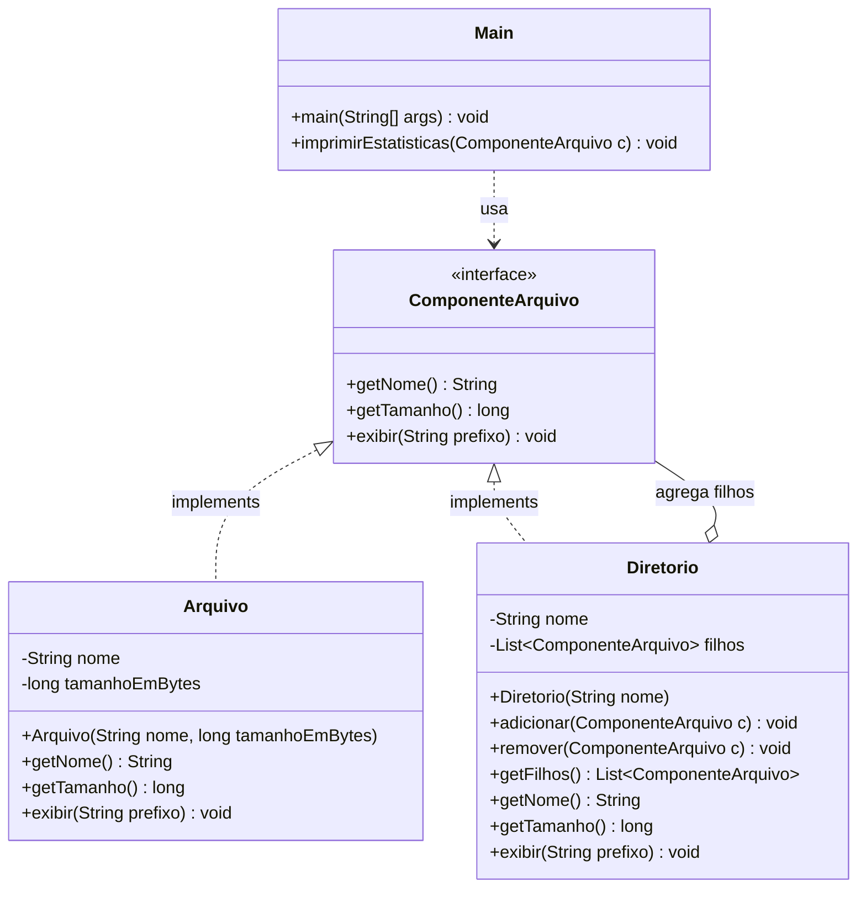

# Relatório Técnico: Implementação e Análise do Padrão de Projeto Composite

**Disciplina:** Análise e Projeto de Sistemas II  
**Linguagem de Implementação:** Java (JDK 25 / compatível com Java 8+)  
**Tema:** Padrão Estrutural Composite (GoF - *Gang of Four*)  

---

## 1. Introdução

No desenvolvimento de software orientado a objetos, frequentemente nos deparamos com problemas nos quais os dados são organizados naturalmente de forma hierárquica (em formato de árvore). Nesses cenários, existem objetos primitivos (elementos finais que não contêm outros elementos) e objetos compostos (contêineres que agregam tanto elementos primitivos quanto outros contêineres).

Sem um padrão de projeto adequado, o código cliente precisaria verificar constantemente o tipo de cada objeto antes de executar uma operação (usando instruções condicionais complexas como `if (obj instanceof Diretorio)` ou switches), resultando em alto acoplamento, duplicação de lógica e violação de princípios fundamentais como o **Princípio Aberto/Fechado (OCP - *Open/Closed Principle*)**.

O padrão de projeto **Composite**, classificado pelo GoF como um padrão **estrutural**, soluciona esse problema ao permitir que objetos individuais e composições de objetos sejam tratados de forma uniforme e transparente por meio de uma interface comum.

---

## 2. O Problema e a Solução Proposta

### 2.1. Cenário Escolhido: Sistema de Gerenciamento de Arquivos
Para exemplificar o padrão de forma didática e aderente à realidade de sistemas operacionais, desenvolvemos um **Gerenciador de Sistema de Arquivos (File System)**.

Neste domínio:
- Um **Arquivo** é um elemento primitivo (folha) que possui um nome e um tamanho fixo em bytes.
- Um **Diretório** é um elemento composto que pode conter arquivos individuais e outros diretórios (subdiretórios).
- O cliente precisa ser capaz de calcular o tamanho de qualquer elemento e exibir a estrutura visualmente, sem se preocupar se o alvo da operação é um simples arquivo de texto de 500 bytes ou um diretório raiz que contém milhares de pastas aninhadas.

---

## 3. Estrutura e Papéis do Padrão Composite

O padrão Composite é composto por quatro papéis principais:

1. **Component (`ComponenteArquivo`):** Interface ou classe abstrata que declara a interface comum para todos os elementos da árvore (operações de negócio como `getTamanho()` e `exibir()`).
2. **Leaf / Folha (`Arquivo`):** Representa os nós terminais da hierarquia. Uma folha não possui filhos e implementa o comportamento primitivo diretamente.
3. **Composite / Composto (`Diretorio`):** Armazena referências para componentes filhos (folhas ou outros composites) e implementa os métodos da interface delegando as operações recursivamente para seus filhos.
4. **Client (`Main`):** Interage com todos os elementos da árvore por meio da interface `Component`, sem necessidade de conhecer suas classes concretas.

### 3.1. Diagrama de Classes UML (Mermaid)



---

## 4. Detalhamento do Código Desenvolvido

### 4.1. Interface `ComponenteArquivo` (Component)
Define o contrato uniforme para o sistema de arquivos. Qualquer operação que se aplique tanto a um arquivo quanto a um diretório é declarada aqui.

```java
package composite;

public interface ComponenteArquivo {
    String getNome();
    long getTamanho();
    void exibir(String prefixo);
}
```

### 4.2. Classe `Arquivo` (Leaf)
Implementa a interface fornecendo o comportamento básico de um arquivo. Como é uma folha, não gerencia filhos:
- `getTamanho()`: simplesmente retorna o atributo `tamanhoEmBytes`.
- `exibir()`: imprime as informações do arquivo com o recuo apropriado.

```java
package composite;

public class Arquivo implements ComponenteArquivo {
    private final String nome;
    private final long tamanhoEmBytes;

    public Arquivo(String nome, long tamanhoEmBytes) {
        if (tamanhoEmBytes < 0) {
            throw new IllegalArgumentException("O tamanho não pode ser negativo.");
        }
        this.nome = nome;
        this.tamanhoEmBytes = tamanhoEmBytes;
    }

    @Override
    public String getNome() { return this.nome; }

    @Override
    public long getTamanho() { return this.tamanhoEmBytes; }

    @Override
    public void exibir(String prefixo) {
        System.out.printf("%s[ARQ] %s (%d bytes)%n", prefixo, this.nome, this.tamanhoEmBytes);
    }
}
```

### 4.3. Classe `Diretorio` (Composite)
Armazena uma coleção de referências do tipo `ComponenteArquivo` (`List<ComponenteArquivo> filhos`), permitindo aninhamento arbitrário de arquivos e subdiretórios.

As operações de negócio aplicam **recursão polimórfica**:
- **Cálculo de tamanho recursivo:**
  ```java
  @Override
  public long getTamanho() {
      long total = 0;
      for (ComponenteArquivo filho : filhos) {
          total += filho.getTamanho(); // Se filho for Diretorio, ocorre nova chamada recursiva
      }
      return total;
  }
  ```
- **Exibição hierárquica recursiva:**
  ```java
  @Override
  public void exibir(String prefixo) {
      System.out.printf("%s[DIR] %s/ (Total: %d bytes)%n", prefixo, this.nome, this.getTamanho());
      for (ComponenteArquivo filho : filhos) {
          filho.exibir(prefixo + "    ");
      }
  }
  ```

### 4.4. Classe de Demonstração `Main` (Client)
Demonstra a criação da árvore com múltiplos níveis de profundidade, a consulta polimórfica e o dinamismo de adicionar/remover elementos:

```java
// O cliente trata tanto o arquivo individual quanto a pasta raiz da mesma forma:
ComponenteArquivo arqReadme = new Arquivo("README.md", 2500);
ComponenteArquivo dirProjeto = new Diretorio("projeto-aps2");

imprimirEstatisticas(arqReadme);   // Funciona diretamente com a Folha
imprimirEstatisticas(dirProjeto);  // Funciona diretamente com o Composto
```

---

## 5. Particularidades de Projeto: Transparência vs. Segurança

Um dos aspectos mais discutidos na literatura sobre o padrão Composite é onde declarar os métodos de manipulação de filhos (`adicionar`, `remover`, `getFilhos`):

| Abordagem | Descrição | Prós | Contras |
| :--- | :--- | :--- | :--- |
| **Transparência** | Os métodos `adicionar` e `remover` são declarados na interface `Component`. | O cliente trata **todos** os elementos de forma 100% idêntica sem precisar fazer casting. | **Perda de segurança em tempo de compilação**: classes Folha (`Arquivo`) precisam implementar métodos vazios ou lançar `UnsupportedOperationException`. |
| **Segurança (Adotada neste projeto)** | Os métodos `adicionar` e `remover` são declarados **somente** na classe concreta `Diretorio`. | **Alta segurança de tipos**: é impossível tentar adicionar um filho a um arquivo em tempo de compilação. Respeita o Princípio de Segregação de Interfaces (ISP). | O cliente precisa ter ciência da classe `Diretorio` no momento da montagem da árvore. |

**Justificativa da escolha:** A abordagem por **Segurança** foi adotada neste projeto pois preserva a coerência do modelo sem gerar operações inválidas em tempo de execução para os arquivos (evitando o lançamento artificial de exceções em nós folha).

---

## 6. Vantagens e Desvantagens do Padrão Composite

### 6.1. Vantagens
1. **Tratamento Uniforme (Polimorfismo):** O código cliente não precisa saber se está interagindo com um único objeto ou com uma estrutura inteira de nós agrupados.
2. **Facilidade de Expansão (Open/Closed Principle):** Novos tipos de nós (por exemplo: `LinkSimbolico`, `ArquivoCompactadoZip`) podem ser adicionados ao sistema criando novas classes que implementam `ComponenteArquivo`, sem alterar uma única linha do código existente.
3. **Eliminação de Condicionais Complexas:** Elimina a necessidade de blocos extensos de `if/else`, `instanceof` e conversões de tipo manuais para navegar na estrutura.
4. **Hierarquias Recursivas Naturais:** Modela com fidelidade árvores complexas (sistemas de arquivos, organogramas empresariais, menus de navegação, árvores DOM).

### 6.2. Desvantagens
1. **Dificuldade em Restringir Tipos:** Se a regra de negócio exigir que certo diretório aceite apenas determinados tipos de componentes (ex.: uma pasta "Imagens" só aceitar arquivos `.png`), essa validação precisará ser feita em tempo de execução (`runtime`), perdendo parte da checagem do compilador.
2. **Risco de Referências Circulares (Loops Infinitos):** Se um diretório for adicionado como filho de si mesmo ou de um de seus descendentes, haverá um ciclo que causará `StackOverflowError` nas chamadas recursivas. Para mitigar isso, foram adicionadas validações defensivas no método `adicionar`.
3. **Complexidade Adicional para Estruturas Simples:** Para cenários com hierarquia plana ou pouco dinâmica, o padrão pode representar uma sobrecarga de abstrações desnecessária.

---

## 7. Como Compilar e Executar o Projeto

No terminal (prompt do Windows, PowerShell ou Bash), a partir da pasta raiz do projeto:

### 1. Compilação
```bash
javac -d bin src/composite/*.java
```

### 2. Execução
```bash
java -cp bin composite.Main
```

### 3. Saída Esperada no Terminal
```text
============================================================
  SISTEMA DE GERENCIAMENTO DE ARQUIVOS (PADRAO COMPOSITE)  
============================================================

--- Estrutura Hierarquica do Projeto Completo ---
[DIR] projeto-aps2/ (Total: 246500 bytes)
    [DIR] src/ (Total: 8500 bytes)
        [ARQ] ComponenteArquivo.java (1200 bytes)
        [ARQ] Arquivo.java (1800 bytes)
        [ARQ] Diretorio.java (2400 bytes)
        [ARQ] Main.java (3100 bytes)
    [DIR] docs/ (Total: 235000 bytes)
        [ARQ] Relatorio_Composite.pdf (150000 bytes)
        [ARQ] diagrama_uml.png (85000 bytes)
    [ARQ] README.md (2500 bytes)
    [ARQ] .gitignore (500 bytes)

------------------------------------------------------------
--- Transparencia no Uso do Componente (Polimorfismo) ---
O cliente trata tanto a folha quanto o composite da mesma forma:

Componente: 'README.md' | Tamanho Calculado: 2500 bytes
Componente: 'src' | Tamanho Calculado: 8500 bytes
Componente: 'projeto-aps2' | Tamanho Calculado: 246500 bytes
------------------------------------------------------------
--- Modificacao Dinamica: Removendo o diagrama_uml.png ---
Novo tamanho da pasta 'docs': 150000 bytes
Novo tamanho total do projeto: 161500 bytes

--- Estrutura Atualizada do Projeto ---
[DIR] projeto-aps2/ (Total: 161500 bytes)
    [DIR] src/ (Total: 8500 bytes)
        [ARQ] ComponenteArquivo.java (1200 bytes)
        [ARQ] Arquivo.java (1800 bytes)
        [ARQ] Diretorio.java (2400 bytes)
        [ARQ] Main.java (3100 bytes)
    [DIR] docs/ (Total: 150000 bytes)
        [ARQ] Relatorio_Composite.pdf (150000 bytes)
    [ARQ] README.md (2500 bytes)
    [ARQ] .gitignore (500 bytes)

============================================================
  Execucao concluida com sucesso!
============================================================
```

---

## 8. Conclusão

O padrão estrutural **Composite** provou ser uma solução elegante e poderosa para representar hierarquias do tipo parte-todo. Ao encapsular a complexidade da iteração e da recursão dentro dos nós compostos (`Diretorio`), o sistema preserva o baixo acoplamento e facilita manutenções futuras. 

Para a disciplina de Análise e Projeto de Sistemas II, este projeto evidencia como os conceitos de polimorfismo, interfaces e coesão podem ser combinados para produzir um código limpo, legível e altamente sustentável.

---

## 9. Referências Bibliográficas

1. **GAMMA, Erich et al.** *Design Patterns: Elements of Reusable Object-Oriented Software*. Reading: Addison-Wesley, 1994. (GoF).
2. **FREEMAN, Eric; ROBSON, Elisabeth.** *Use a Cabeça! Padrões de Projetos*. 2. ed. Rio de Janeiro: Alta Books, 2021.
3. **FOWLER, Martin.** *Refactoring: Improving the Design of Existing Code*. 2. ed. Boston: Addison-Wesley, 2018.
